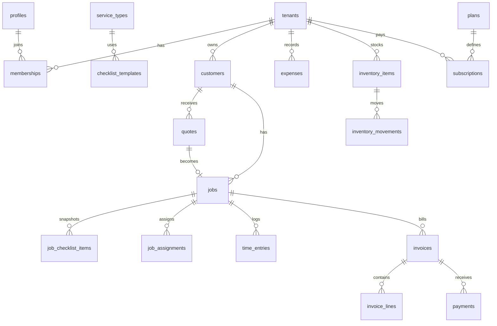

# BrillaPro — Modelo de datos

Implementado hasta la Fase 4 (migraciones `db/migrations/0001`–`0011`). Lo de fases posteriores es propuesta.

## Tablas por fase
- F1: tenants, profiles, memberships, audit_log, tenant_settings, plans, subscriptions (trial por defecto)
- F2: customers, customer_documents
- F3: service_types, checklist_templates, checklist_template_items, quotes, quote_options, quote_lines
- F4: jobs, job_assignments, job_checklist_items (snapshot), recurring_schedules, time_entries, notes, tasks
- F5: invoices, invoice_lines, payments, expense_categories, expenses
- F6: inventory_items, inventory_movements
- F7: import_batches, bank_transactions, accounts, journal_entries, journal_lines, accounting_periods
- F8: integrations

## Fase 3 (implementado)
- service_types (7 por defecto por empresa, sin borrado: se desactivan), checklist_templates (una activa por tipo de servicio), checklist_template_items.
- quotes (numeración por empresa vía tenant_counters), quote_options (Good/Better/Best), quote_lines (conceptos extra sobre toda opción).
- Totales en SQL: función `quote_totals` y vista `quotes_overview`; estados vía `set_quote_status`, copia vía `duplicate_quote`. Solo los borradores se editan.
- tenant_settings: quote_prefix, quote_valid_days, default_tax_rate, quote_terms.

## Fase 4 (implementado)
- employees (con `user_id` opcional para vincular una cuenta), jobs (con snapshot de cliente/dirección y `quote_id` único por cotización), job_assignments, job_checklist_items (copia de la plantilla activa al crear el trabajo).
- Los empleados con cuenta solo ven los trabajos que tienen asignados (`is_assigned`); cambian estado y marcan tareas mediante funciones (`set_job_status`, `set_job_item_done`).
- recurring_schedules + recurring_schedule_employees; `generate_recurring_jobs` crea trabajos de forma idempotente (índice único por programación y fecha) y solo bajo demanda; `end_recurring`.
- time_entries (una entrada abierta por empleado; `clock_in`/`clock_out`/`add_time_entry`), user_notes (privadas del autor), tasks (`set_task_done`).

## Fase 5 (implementado)
- invoices (numeración por empresa, solo los borradores se editan), invoice_lines, payments. Totales y saldo en SQL (`invoice_totals`, vista `invoices_overview`); los pagos solo entran por `record_payment` (valida el saldo); anular solo si no hay pagos. Contador: solo lectura para el contable.
- expense_categories (8 por defecto según el idioma; se desactivan, no se borran; escriben owner/admin), expenses (owner/admin/office escriben, solo owner/admin borran, contable lee), `expense_summary(desde, hasta)`.
- Storage: bucket privado `receipts` (5 MB; jpeg/png/webp/pdf). Ruta `<tenant_id>/<expense_id>/<archivo>`; las políticas usan el primer segmento (`storage_tenant`). Ver con URL firmada de 5 min.

## Fase 6 (implementado)
- inventory_items (se desactivan, no se borran; mínimo para alerta de stock bajo, costo opcional) e inventory_movements (compra, uso, ajuste; cantidad con signo; inmutables: las correcciones son ajustes). Un trigger bloquea el artículo y rechaza movimientos que dejen el stock en negativo. Vista `inventory_overview` (existencia y bandera de stock bajo). Acceso: owner/admin/manager.
- Funciones de reportes (security invoker, la RLS decide qué ve cada rol): `report_jobs`, `report_hours` (solo entradas cerradas, en la zona horaria de la empresa), `report_money` (facturado, cobrado y gastos).

## Fase 9 (en curso)
- plans: starter, pro y business (más trial) con `limits.max_users`; `tenant_usage(tenant)` (personas activas y límite, solo miembros) y un trigger en memberships que impide pasar el límite del plan (bloquea la fila del tenant para evitar carreras). La prueba gratis permite 10 personas.

## Convenciones
UUID, `created_at`, `updated_at`, `archived_at`; `tenant_id NOT NULL` con FK; dinero en centavos enteros;
FK compuestas `(tenant_id, id)`; índices en `(tenant_id, ...)`; migraciones SQL versionadas, primero en staging;
cambios destructivos solo con aprobación.

## ER (alto nivel)

### Equipo e invitaciones (migración 0018)

- `invitations`: correo, rol (nunca `owner`), `token_hash` (solo se guarda el hash SHA-256; el token se muestra una vez), estado pending/accepted/revoked, vence a los 7 días. Solo owner/admin pueden leerla; todas las escrituras pasan por funciones.
- `create_invitation` (owner/admin; solo el owner invita admins; las pendientes reservan un lugar del plan), `revoke_invitation`, `invitation_preview` y `accept_invitation` (el correo de la cuenta debe coincidir y estar confirmado; una persona, una empresa).
- Trigger `memberships_protect`: la empresa nunca se queda sin dueño y nadie cambia su propio rol/estado.
- La entrega es un enlace que el dueño copia o envía con `mailto:`; no hay proveedor de correo conectado.

### Super Admin (migración 0019)

- `is_platform_admin()`; las funciones `platform_companies`, `platform_set_company_status`, `platform_set_plan` y `platform_extend_trial` solo responden a quien esté en `platform_admins`. No se usa la clave de servicio en la app. Solo ven conteos y estado, nunca datos de clientes, dinero ni documentos.
- Cada cambio queda en `audit_log` de la empresa afectada (`platform.*`).
- Una empresa suspendida (`tenants.status = 'suspended'`) deja de pasar `is_member`/`has_role`, así que todas las políticas RLS la bloquean; `my_company_suspended()` permite mostrar la página `/suspended`.
- Dar acceso de Super Admin se hace a mano: `npm run admin:grant -- correo@ejemplo.com` (no existe desde la app).

### Revisión de seguridad (9e)

- Todas las tablas de `public` tienen RLS salvo `schema_migrations` (interna). `anon` no tiene permisos sobre tablas.
- Solo `submit_quote_request` y `public_company_name` son funciones privilegiadas que visitantes pueden ejecutar (a propósito); las demás que ven son triggers o helpers sin privilegios.
- Todas las funciones SECURITY DEFINER fijan `search_path`. Las vistas usan `security_invoker`. El bucket `receipts` es privado.
- Formulario público: honeypot, tiempo mínimo, límite por empresa en la base y Turnstile opcional (`NEXT_PUBLIC_TURNSTILE_SITE_KEY` / `TURNSTILE_SECRET_KEY`).

### Lista de clientes (migración 0020)

- `customers.rating` (1 a 5, la pone el usuario a mano; editable desde el formulario del cliente).
- `customer_list_extras(ids)`: por cliente, saldo pendiente y vencido, y el último trabajo iniciado con horas reales (entradas/salidas) contra horas planeadas (ventana programada × personas asignadas). Corre con los permisos de quien consulta: sin acceso a facturas ve ceros.
- `customers_summary()`: monto vencido, total pendiente y cotizaciones en borrador.
