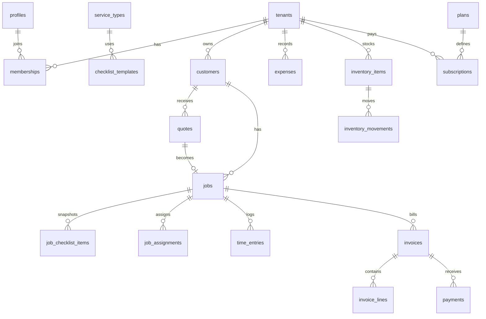

# BrillaPro — Modelo de datos

Implementado hasta la Fase 4 (migraciones `db/migrations/0001`–`0011`). Lo de fases posteriores es propuesta.

## Tablas por fase
- F1: tenants, profiles, memberships, audit_log, tenant_settings, plans, subscriptions (trial por defecto)
- F2: customers, customer_documents
- F3: service_types, checklist_templates, checklist_template_items, quotes, quote_options, quote_lines
- F4: jobs, job_assignments, job_checklist_items (snapshot), recurring_schedules, time_entries, notes, tasks
- F5: invoices, invoice_lines, payments, expense_categories, expenses
- F6: inventory_items, inventory_movements
- F7: import_batches, bank_transactions, accounts, journal_entries, journal_lines, accounting_periods
- F8: integrations

## Fase 3 (implementado)
- service_types (7 por defecto por empresa, sin borrado: se desactivan), checklist_templates (una activa por tipo de servicio), checklist_template_items.
- quotes (numeración por empresa vía tenant_counters), quote_options (Good/Better/Best), quote_lines (conceptos extra sobre toda opción).
- Totales en SQL: función `quote_totals` y vista `quotes_overview`; estados vía `set_quote_status`, copia vía `duplicate_quote`. Solo los borradores se editan.
- tenant_settings: quote_prefix, quote_valid_days, default_tax_rate, quote_terms.

## Fase 4 (implementado)
- employees (con `user_id` opcional para vincular una cuenta), jobs (con snapshot de cliente/dirección y `quote_id` único por cotización), job_assignments, job_checklist_items (copia de la plantilla activa al crear el trabajo).
- Los empleados con cuenta solo ven los trabajos que tienen asignados (`is_assigned`); cambian estado y marcan tareas mediante funciones (`set_job_status`, `set_job_item_done`).
- recurring_schedules + recurring_schedule_employees; `generate_recurring_jobs` crea trabajos de forma idempotente (índice único por programación y fecha) y solo bajo demanda; `end_recurring`.
- time_entries (una entrada abierta por empleado; `clock_in`/`clock_out`/`add_time_entry`), user_notes (privadas del autor), tasks (`set_task_done`).

## Fase 5 (implementado)
- invoices (numeración por empresa, solo los borradores se editan), invoice_lines, payments. Totales y saldo en SQL (`invoice_totals`, vista `invoices_overview`); los pagos solo entran por `record_payment` (valida el saldo); anular solo si no hay pagos. Contador: solo lectura para el contable.
- expense_categories (8 por defecto según el idioma; se desactivan, no se borran; escriben owner/admin), expenses (owner/admin/office escriben, solo owner/admin borran, contable lee), `expense_summary(desde, hasta)`.
- Storage: bucket privado `receipts` (5 MB; jpeg/png/webp/pdf). Ruta `<tenant_id>/<expense_id>/<archivo>`; las políticas usan el primer segmento (`storage_tenant`). Ver con URL firmada de 5 min.

## Fase 6 (implementado)
- inventory_items (se desactivan, no se borran; mínimo para alerta de stock bajo, costo opcional) e inventory_movements (compra, uso, ajuste; cantidad con signo; inmutables: las correcciones son ajustes). Un trigger bloquea el artículo y rechaza movimientos que dejen el stock en negativo. Vista `inventory_overview` (existencia y bandera de stock bajo). Acceso: owner/admin/manager.
- Funciones de reportes (security invoker, la RLS decide qué ve cada rol): `report_jobs`, `report_hours` (solo entradas cerradas, en la zona horaria de la empresa), `report_money` (facturado, cobrado y gastos).

## Fase 9 (en curso)
- plans: **starter** ($39/mes: 1 persona, 50 clientes, reportes esenciales) y **pro** ($79/mes: 10 personas, clientes sin tope, todos los reportes), más trial (10 personas, sin tope de clientes). La fila `business` anterior se conserva pero ya no se ofrece. `limits.max_users` y `limits.max_customers`; `tenant_usage(tenant)` devuelve personas y clientes (no archivados) con sus límites (solo miembros); triggers en memberships y customers impiden pasar el límite (bloquean la fila del tenant para evitar carreras; restaurar un cliente archivado también cuenta). Migración 0027. Pendiente: limitar reportes del Starter.

## Convenciones
UUID, `created_at`, `updated_at`, `archived_at`; `tenant_id NOT NULL` con FK; dinero en centavos enteros;
FK compuestas `(tenant_id, id)`; índices en `(tenant_id, ...)`; migraciones SQL versionadas, primero en staging;
cambios destructivos solo con aprobación.

## ER (alto nivel)

### Equipo e invitaciones (migración 0018)

- `invitations`: correo, rol (nunca `owner`), `token_hash` (solo se guarda el hash SHA-256; el token se muestra una vez), estado pending/accepted/revoked, vence a los 7 días. Solo owner/admin pueden leerla; todas las escrituras pasan por funciones.
- `create_invitation` (owner/admin; solo el owner invita admins; las pendientes reservan un lugar del plan), `revoke_invitation`, `invitation_preview` y `accept_invitation` (el correo de la cuenta debe coincidir y estar confirmado; una persona, una empresa).
- Trigger `memberships_protect`: la empresa nunca se queda sin dueño y nadie cambia su propio rol/estado.
- La entrega es un enlace que el dueño copia o envía con `mailto:`; no hay proveedor de correo conectado.

### Super Admin (migración 0019)

- `is_platform_admin()`; las funciones `platform_companies`, `platform_set_company_status`, `platform_set_plan` y `platform_extend_trial` solo responden a quien esté en `platform_admins`. No se usa la clave de servicio en la app. Solo ven conteos y estado, nunca datos de clientes, dinero ni documentos.
- Cada cambio queda en `audit_log` de la empresa afectada (`platform.*`).
- Una empresa suspendida (`tenants.status = 'suspended'`) deja de pasar `is_member`/`has_role`, así que todas las políticas RLS la bloquean; `my_company_suspended()` permite mostrar la página `/suspended`.
- Dar acceso de Super Admin se hace a mano: `npm run admin:grant -- correo@ejemplo.com` (no existe desde la app).

### Revisión de seguridad (9e)

- Todas las tablas de `public` tienen RLS salvo `schema_migrations` (interna). `anon` no tiene permisos sobre tablas.
- Solo `submit_quote_request` y `public_company_name` son funciones privilegiadas que visitantes pueden ejecutar (a propósito); las demás que ven son triggers o helpers sin privilegios.
- Todas las funciones SECURITY DEFINER fijan `search_path`. Las vistas usan `security_invoker`. El bucket `receipts` es privado.
- Formulario público: honeypot, tiempo mínimo, límite por empresa en la base y Turnstile opcional (`NEXT_PUBLIC_TURNSTILE_SITE_KEY` / `TURNSTILE_SECRET_KEY`).

### Lista de clientes (migración 0020)

- `customers.rating` (1 a 5, la pone el usuario a mano; editable desde el formulario del cliente).
- `customer_list_extras(ids)`: por cliente, saldo pendiente y vencido, y el último trabajo iniciado con horas reales (entradas/salidas) contra horas planeadas (ventana programada × personas asignadas). Corre con los permisos de quien consulta: sin acceso a facturas ve ceros.
- `customers_summary()`: monto vencido, total pendiente y cotizaciones en borrador.

### Editor de facturas (migración 0021)
- **Logo de la empresa**: bucket privado `logos` (PNG/JPG, máx. 1 MB), archivos en `<tenant_id>/<archivo>`. Lo leen todos los miembros de la empresa; solo owner/admin suben o borran. `tenant_settings.logo_path` apunta al archivo. La pantalla usa una URL firmada de 1 hora; el PDF descarga los bytes.
- **`save_invoice_draft(p_id, p_header jsonb, p_lines jsonb)`**: guarda encabezado + todos los conceptos en una sola transacción, con `position` según el orden recibido. Solo borradores; roles owner/admin/office_staff; el cliente debe ser de la misma empresa; máx. 100 conceptos. Si algo falla, no se guarda nada.

### Editor de cotizaciones (migración 0026)
- **`save_quote_draft(p_id, p_header jsonb, p_options jsonb, p_lines jsonb)`**: guarda encabezado (cliente, servicio, título, fechas, descuento, impuesto, notas, términos), opciones y conceptos adicionales en una sola transacción, con `position` según el orden recibido. Solo borradores; roles owner/admin/manager/office_staff; cliente y servicio deben ser de la misma empresa; máx. 12 opciones y 100 conceptos. Si algo falla, no se guarda nada.

### Centro de reportes (migración 0028)
- **`report_favorites`** (tenant_id, user_id, report_key): reportes marcados con estrella, privados de cada persona (RLS: solo sus filas y solo en su empresa).
- **`report_sales_tax(p_from, p_to)`**: impuesto por factura enviada en el periodo (base gravable, tasa, impuesto, total). `security invoker`: aplica RLS.
- Reportes disponibles: detalle de facturas, ventas por concepto, ingresos por cliente, antigüedad de saldos, pagos cobrados, ganancias y pérdidas (base efectivo), impuesto sobre ventas, gastos, resumen del negocio y reportes bancarios (Venmo). No posibles aún: cuentas por pagar (no hay facturas de proveedores) y saldo a favor (no hay créditos de clientes).

### Estados de cuenta bancarios (migración 0029)
- **`bank_categories`** (tenant_id, parent_id, name, keywords, sort_order, is_active): categorías de dos niveles (principal → subcategoría; un trigger impide más niveles y que una categoría sea su propio padre). Nombre único por empresa y nivel. `keywords` (separadas por coma) clasifican solas los movimientos al importar. Nunca se borran: se ocultan (`is_active`) y los movimientos pasados las conservan.
- **`bank_transactions`** (tenant_id, tx_date, description, amount_cents con signo —positivo depósito, negativo retiro—, balance_cents, category_id, source, dedupe_key, created_by). `unique (tenant_id, dedupe_key)`: importar dos veces el mismo estado de cuenta no duplica movimientos.
- RLS (migración 0030): owner y admin leen y escriben; accountant solo lee (el contador es de solo lectura en todo el sistema); siempre dentro de su empresa.
- **`ensure_bank_categories(p_tenant, p_locale)`**: crea una sola vez el juego inicial de la empresa (migración 0031: Publicidad, Vehículo, Oficina, Renta, Insumos, Ingresos, etc., con sus subcategorías y palabras clave; nombres en inglés). Solo owner/admin. Las empresas que tenían el juego genérico de 0029 reciben el nuevo y el anterior queda oculto, no borrado.
- El PDF se lee en el servidor (`unpdf`, sin servicios externos) y **no se guarda**; la persona revisa los movimientos antes de importarlos.

### Saldos del banco (migración 0032)
- **`bank_statements`** (tenant_id, period_start, period_end, beginning_balance_cents, ending_balance_cents, source): el saldo anterior y el saldo final que imprime el banco en cada estado de cuenta importado. Un estado por periodo (`unique (tenant_id, period_start, period_end)`); al reimportar con saldos corregidos se actualizan. RLS: owner/admin escriben, accountant solo lee.
- El reporte de movimientos (pantalla y PDF) parte del saldo anterior del banco: saldo anterior + depósitos − retiros = saldo final, y lo compara con el saldo final del banco (coincide / diferencia). Solo aparece sin búsqueda ni filtro de tipo o categoría; con filtro de mes usa los estados que terminan en ese mes, sin él encadena todos.

- `bank_transactions.notes` (migración 0033): notas opcionales (máx. 500). Al editar un movimiento, cambiar el tipo (Ingreso/Gasto) cambia el signo de `amount_cents`, y con eso la columna (depósitos o retiros).

- `invoices.customer_phone` (migración 0034): el teléfono del cliente queda guardado en la factura, igual que nombre, correo y dirección. Un borrador sigue al cliente (un trigger lo actualiza en cada guardado); al emitirse queda congelado y ya no cambia aunque se edite el cliente. Las facturas anteriores recibieron el teléfono actual del cliente.
- Importar un estado de cuenta ya cargado corrige en su lugar los movimientos que quedaron con el signo contrario (mismo día, mismo saldo, misma descripción), sin duplicarlos.

- Categorías compartidas (migración 0036): los gastos ahora usan las mismas categorías de dos niveles que Reportes bancarios (`bank_categories`); `expenses.category_id` apunta a ellas. Los gastos existentes se movieron a la categoría equivalente (o a "Other expenses" con su mismo nombre); `expense_categories` queda sin uso, sin borrarse. Las empresas nuevas reciben la lista al crearse. Quienes registran gastos (office staff incluido) pueden leer la lista; solo owner/admin la cambian. Se administra desde Reportes bancarios > Categories o desde Settings (lista simple), en cualquier plan.
