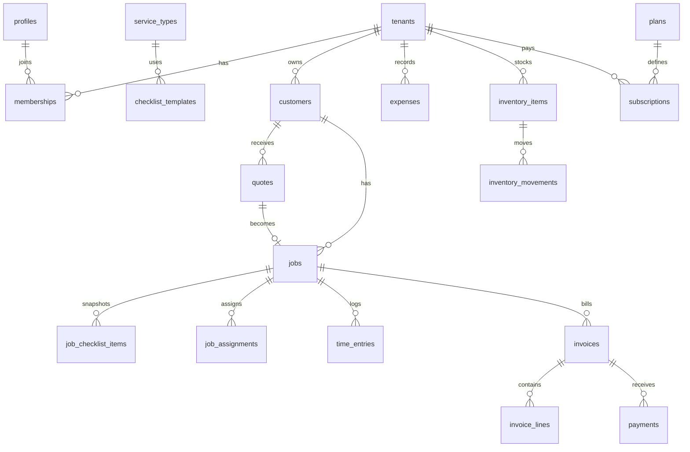

# BrillaPro — Modelo de datos inicial (propuesta; sin tablas creadas)

## Tablas por fase
- F1: tenants, profiles, memberships, audit_log, tenant_settings, plans, subscriptions (trial por defecto)
- F2: customers, customer_documents
- F3: service_types, checklist_templates, checklist_template_items, quotes, quote_options, quote_lines
- F4: jobs, job_assignments, job_checklist_items (snapshot), recurring_schedules, time_entries, notes, tasks
- F5: invoices, invoice_lines, payments, expense_categories, expenses
- F6: inventory_items, inventory_movements
- F7: import_batches, bank_transactions, accounts, journal_entries, journal_lines, accounting_periods
- F8: integrations

## Convenciones
UUID, `created_at`, `updated_at`, `archived_at`; `tenant_id NOT NULL` con FK; dinero en centavos enteros;
FK compuestas `(tenant_id, id)`; índices en `(tenant_id, ...)`; migraciones SQL versionadas, primero en staging;
cambios destructivos solo con aprobación.

## ER (alto nivel)

